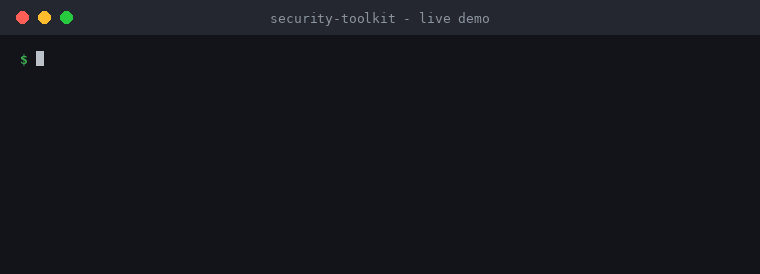
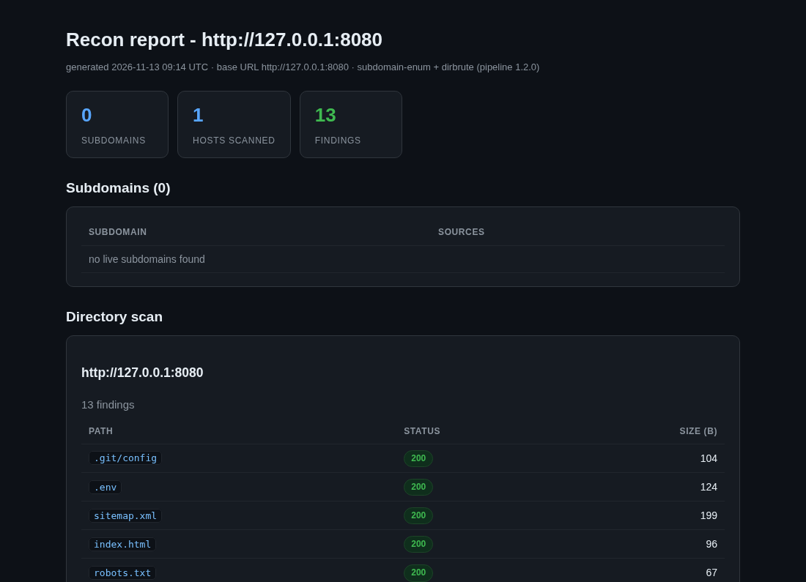

# Security

[](https://github.com/Abolfazlrwm/Security/actions/workflows/ci.yml)
[](https://github.com/Abolfazlrwm/Security/actions/workflows/release.yml)

A compact toolkit of network reconnaissance, auditing and analysis tools —
nine utilities in Python and Go with zero third-party dependencies, from
subdomain discovery and port scanning to JWT auditing and CVE triage,
wired together by a one-command pipeline.

> **Authorized use only.** These tools are meant for education, CTFs and
> testing systems you own or have explicit permission to assess.

## Demo

Three tools against a local demo target, exactly as captured in
[examples/](examples/) — hash cracking, directory brute force and the
consolidated pipeline:



## Tools

| Tool | Language | What it does |
| --- | --- | --- |
| [subdomain-enum](subdomain-enum/) | Python 3 | Subdomain discovery via crt.sh and threaded DNS brute force |
| [port-scanner](port-scanner/) | Python 3 | TCP connect scan of a curated top-100 list with banner grabbing |
| [takeover-check](takeover-check/) | Python 3 | Subdomain takeover detection with CNAME + body fingerprints for 17 hosting services |
| [web-audit](web-audit/) | Python 3 | TLS certificate + security-header audit that scores targets 0-100 with a letter grade |
| [jwt-analyzer](jwt-analyzer/) | Python 3 | Offline JWT audit: decode, verify HMAC signatures, crack weak secrets, flag `alg: none` and claim defects |
| [cve-lookup](cve-lookup/) | Python 3 | Turn banners, keywords or CVE ids into CVSS-ranked CVE lists via the official NVD API — chains from port-scanner JSON |
| [dirbrute](dirbrute/) | Go | Threaded directory and file brute-forcer with wildcard filtering |
| [hashcrack](hashcrack/) | Python 3 | MD5 / SHA-1 / SHA-256 / SHA-512 cracking with wordlists and rule chains |
| [recon-pipeline](recon-pipeline/) | Python 3 | Chains subdomain-enum, port-scanner, web-audit and dirbrute into one HTML/JSON/Markdown report |

Step-by-step tutorials with every flag explained live in
[docs/tutorials/](docs/tutorials/).

## Downloads

Release tags build standalone binaries automatically and attach them, with
sha256 checksums, to the matching GitHub release:

| Tool | Platforms | Release |
| --- | --- | --- |
| dirbrute | linux (amd64, arm64), macOS (amd64, arm64), windows | [dirbrute-v1.1.1](https://github.com/Abolfazlrwm/Security/releases/tag/dirbrute-v1.1.1) |
| subdomain-enum | linux, macOS (arm64), windows | [subdomain-enum-v1.2.0](https://github.com/Abolfazlrwm/Security/releases/tag/subdomain-enum-v1.2.0) |
| hashcrack | linux, macOS (arm64), windows | [hashcrack-v1.2.0](https://github.com/Abolfazlrwm/Security/releases/tag/hashcrack-v1.2.0) |
| port-scanner | linux, macOS (arm64), windows | [port-scanner-v1.0.0](https://github.com/Abolfazlrwm/Security/releases/tag/port-scanner-v1.0.0) |
| takeover-check | linux, macOS (arm64), windows | [takeover-check-v1.0.0](https://github.com/Abolfazlrwm/Security/releases/tag/takeover-check-v1.0.0) |
| web-audit | linux, macOS (arm64), windows | [web-audit-v1.0.0](https://github.com/Abolfazlrwm/Security/releases/tag/web-audit-v1.0.0) |
| jwt-analyzer | linux, macOS (arm64), windows | [jwt-analyzer-v1.0.0](https://github.com/Abolfazlrwm/Security/releases/tag/jwt-analyzer-v1.0.0) |
| cve-lookup | linux, macOS (arm64), windows | [cve-lookup-v1.0.0](https://github.com/Abolfazlrwm/Security/releases/tag/cve-lookup-v1.0.0) |

dirbrute is cross-compiled with the Go toolchain; the Python tools are
packaged with PyInstaller. Both paths smoke-test every artifact inside the
release workflow before it gets published, so each binary runs without any
interpreter, runtime or third-party package.

## Quick start

### Subdomain enumeration

```console
$ python3 subdomain-enum/subdomain_enum.py example.com -f json -o subs.json
$ python3 subdomain-enum/subdomain_enum.py example.com --no-crtsh -t 50
```

### Directory brute force

```console
$ make build                 # compiles dirbrute/dirbrute (Go 1.19+)
$ ./dirbrute/dirbrute -u https://target/ -t 30
$ ./dirbrute/dirbrute -u https://target/ -w paths.txt -x php,html -o found.txt
```

### Hash cracking

```console
$ python3 hashcrack/hashcrack.py --hash 5f4dcc3b5aa765d61d8327deb882cf99
$ python3 hashcrack/hashcrack.py --hashes hashes.txt --rules capitalize,append2
```

### Port scanning

```console
$ python3 port-scanner/port_scanner.py scanme.nmap.org --top 100
$ python3 port-scanner/port_scanner.py 10.0.0.5 --ports 22,80,443,8000-8100
```

### Subdomain takeover check

```console
$ python3 takeover-check/takeover_check.py -f subs.json
$ python3 takeover-check/takeover_check.py blog.example.com old.example.com
```

### Web audit

```console
$ python3 web-audit/web_audit.py example.com
$ python3 web-audit/web_audit.py https://host:8443 --format json
```

### JWT audit

```console
$ python3 jwt-analyzer/jwt_analyzer.py "$TOKEN" --secret "$HS_SECRET"
$ python3 jwt-analyzer/jwt_analyzer.py "$(cat token.txt)" --wordlist secrets.txt
```

### CVE lookup (chains from a port scan)

```console
$ python3 port-scanner/port_scanner.py scanme.nmap.org --ports 22,80 --format json --output scan.json
$ python3 cve-lookup/cve_lookup.py --from-scan scan.json --severity critical,high
$ python3 cve-lookup/cve_lookup.py --cve CVE-2021-44228
```

### Full recon run

```console
$ make build
$ python3 recon-pipeline/recon.py --domain example.com
$ python3 recon-pipeline/recon.py --hosts web01,web02 --url https://staging.internal
```

The pipeline chains four tools — subdomain enumeration, port scan, web
audit, directory brute force — and every phase can be skipped
(`--skip-ports`, `--skip-audit`, `--skip-dirbrute`).

Every pipeline run writes `report.html` (a self-contained, dark-themed
report page), `report.md`, `report.json` and the raw tool logs into
`reports/<target>-<timestamp>/`.

## Reports

`report.html` embeds its styles and references no external asset, so it
renders offline in any browser and can be shared as a single file. This
is the captured report from
[examples/recon-pipeline/](examples/recon-pipeline/report.html):



## Examples

The [examples/](examples/) directory contains captured output from real
runs of every tool: a directory scan against a local demo webserver,
three hash-cracking sessions (plain lookup, rule chain, salted digest),
a verified subdomain enumeration of `debian.org`, a port scan of
`scanme.nmap.org` (Nmap's public scan-me target) whose JSON report is
chained straight into the CVE lookup of its OpenSSH banner, a takeover
check with three verdict shapes, a header audit of `example.com` that
scores it F, two JWT audits (a cracked weak secret and an `alg: none`
bypass), and the consolidated pipeline report. Each artifact records
the exact command that produced it, so you can see the expected output
shape before running anything against your own targets.

## Testing

Two layers of tests keep the toolkit honest (both use the standard
library only):

**Unit tests** — `tests/unit/` covers the pure code paths: hashcrack's
rule engine, salting, target loading and algorithm auto-detection;
subdomain-enum's domain normalisation, label loading and report
writing; port-scanner's port-spec parser, service map, banner trimming
and table renderer; takeover-check's CNAME fingerprint matcher and
verdict logic; web-audit's URL normalisation, header evaluation, cookie
audit and scoring; jwt-analyzer's base64url decoder, HMAC verification,
dictionary attack and finding rules; cve-lookup's banner-to-CPE
guessing, version normalisation, CVE flattening and filters; and
recon-pipeline's dirbrute output parsing, host collection and the
Markdown/HTML renderers (including HTML escaping); and, on the Go side,
dirbrute's flag parsing, wordlist handling, candidate building and
wildcard filtering. Run them with:

```console
$ make test      # Python unit tests
$ make gotest    # Go unit tests
```

**Integration harness** — `tests/integration.py` is a self-contained
harness that spins up a local demo webserver and verifies the whole
toolkit: hashcrack sessions (plain lookup, rule chain, salted digest
and the built-in wordlist fallback), a full dirbrute scan including
wildcard filtering, a live port-scanner pass (open port found, closed
port silent), a web-audit run against the plain-HTTP demo target, a
jwt-analyzer pass (weak secret cracked, `alg: none` flagged, valid
secret verified), and an end-to-end recon-pipeline run whose HTML
report is checked for correctness and self-containment. Network-bound
tools (subdomain-enum, takeover-check, cve-lookup) are exercised
through their `--help` pages so CI never depends on the internet:

```console
$ make build
$ python3 tests/integration.py
ALL CHECKS PASSED
```

`make check` runs all three gates in one go — the same set CI executes
on every push.

## CI/CD (GitHub Actions)

Two workflows keep the toolkit green and ship the binaries. The full
pipeline documentation — job matrices, artifact naming, release routing —
lives in [docs/actions.md](docs/actions.md):

| Workflow | Trigger | Result |
| --- | --- | --- |
| [CI](https://github.com/Abolfazlrwm/Security/actions/workflows/ci.yml) | every push / PR to `main` | Python tools byte-compiled and smoke-tested on 3.11 / 3.12, dirbrute checked with `gofmt`, `go vet` and `go build` on Linux, macOS and Windows, then the full integration harness |
| [Release binaries](https://github.com/Abolfazlrwm/Security/actions/workflows/release.yml) | tags `dirbrute-v*`, `subdomain-enum-v*`, `hashcrack-v*`, `port-scanner-v*`, `takeover-check-v*`, `web-audit-v*`, `jwt-analyzer-v*`, `cve-lookup-v*` | standalone binaries for every supported platform, each smoke-tested before publish, attached to the GitHub release with sha256 checksums |

To cut a release, push an annotated tag and the workflow does the rest:

```console
$ git tag -a dirbrute-v1.2.0 -m "dirbrute 1.2.0"
$ git push origin dirbrute-v1.2.0
```

## Building

The Python tools run on any Python 3.8+ interpreter with no extra packages.
The Go tool needs a Go 1.19+ toolchain:

```console
$ make build     # build the dirbrute binary
$ make vet       # go vet
$ make clean     # remove the binary
```

## Repository layout

```
Security/
├── subdomain-enum/
│   ├── subdomain_enum.py
│   └── wordlists/subdomains.txt
├── port-scanner/
│   └── port_scanner.py
├── takeover-check/
│   └── takeover_check.py
├── web-audit/
│   └── web_audit.py
├── jwt-analyzer/
│   ├── jwt_analyzer.py
│   └── wordlists/secrets.txt
├── cve-lookup/
│   └── cve_lookup.py
├── dirbrute/
│   ├── main.go
│   ├── scanner.go
│   └── wordlists/common.txt
├── hashcrack/
│   ├── hashcrack.py
│   └── wordlists/common-passwords.txt
├── recon-pipeline/
│   └── recon.py
├── examples/          # captured output from real runs
├── tests/
│   ├── integration.py # local end-to-end harness
│   └── unit/          # stdlib unittest suites for the pure code paths
├── docs/
│   ├── actions.md     # CI/CD pipeline documentation
│   ├── demo.gif       # terminal demo of the tools
│   ├── report-screenshot.png
│   └── tutorials/     # step-by-step guides for every tool
├── SECURITY.md        # how to report vulnerabilities
├── CONTRIBUTING.md    # dev setup, gates and release process
└── Makefile
```

## Contributing and security

Bug reports, feature ideas and pull requests are welcome — see
[CONTRIBUTING.md](CONTRIBUTING.md) for the dev setup, the local test
gates, the commit style and the tag-driven release process. To report a
vulnerability, please use GitHub's private security advisory instead of
a public issue — the policy, scope and response targets are in
[SECURITY.md](SECURITY.md).

## License

Released under the [MIT License](LICENSE).
