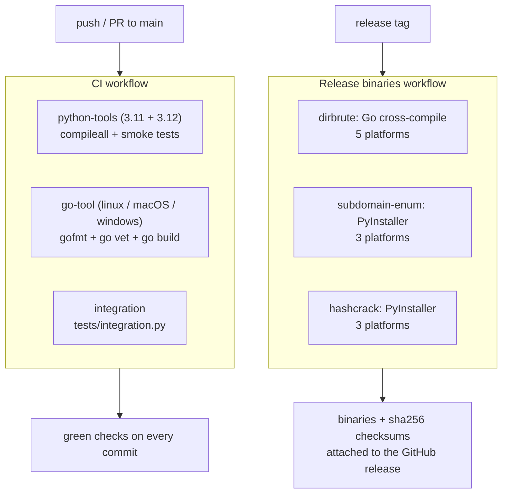

# GitHub Actions — CI/CD

[](https://github.com/Abolfazlrwm/Security/actions/workflows/ci.yml)
[](https://github.com/Abolfazlrwm/Security/actions/workflows/release.yml)

Every commit is checked by a three-job CI pipeline and every release tag
builds downloadable binaries — no manual build steps, no manually uploaded
artifacts. The live run history lives on the
[Actions](https://github.com/Abolfazlrwm/Security/actions) page and the
finished products land on
[Releases](https://github.com/Abolfazlrwm/Security/releases).

## Workflows at a glance

| Workflow | File | Trigger | What it does |
| --- | --- | --- | --- |
| CI | [.github/workflows/ci.yml](../.github/workflows/ci.yml) | push to `main`, pull requests to `main`, manual dispatch | Byte-compiles and smoke-tests the Python tools on 3.11 and 3.12, lints and builds dirbrute on Linux, macOS and Windows, then runs the full integration harness |
| Release binaries | [.github/workflows/release.yml](../.github/workflows/release.yml) | tags `dirbrute-v*`, `subdomain-enum-v*`, `hashcrack-v*` | Builds standalone binaries for every supported platform, smoke-tests each one, and attaches them plus sha256 checksums to the GitHub release |

Both workflows stick to first-party actions — `actions/checkout`,
`actions/setup-python`, `actions/setup-go`, `actions/upload-artifact`,
`actions/download-artifact` and `softprops/action-gh-release`.

## Pipeline



## CI in detail

| Job | Matrix | Steps |
| --- | --- | --- |
| `python-tools` | Python 3.11 and 3.12 on ubuntu-latest | `python -m compileall` across the three Python tools, hashcrack smoke tests (plain lookup and a rule chain), `--help` smoke tests for subdomain-enum and recon-pipeline |
| `go-tool` | ubuntu-latest, macos-latest, windows-latest | force LF line endings (Windows runners otherwise break `gofmt`), `gofmt -l` check, `go vet ./...`, `go build` |
| `integration` | ubuntu-latest | `make build`, then `python3 tests/integration.py` — the harness starts a local demo webserver and exercises the whole toolkit end to end |

All three jobs run in parallel. Concurrency is keyed to the ref
(`ci-${{ github.ref }}`) with `cancel-in-progress: true`, so a newer push
cancels the stale run instead of wasting runner minutes.

## Release pipeline in detail

Tag names follow `<tool>-v<semver>` (for example `dirbrute-v1.1.1`). The
release workflow routes each tag to the right job with
`if: startsWith(github.ref_name, '<tool>-v')`, and runs with
`permissions: contents: write` — the least privilege needed to publish
release assets.

### dirbrute (Go cross-compilation)

A single ubuntu job builds five targets with the Go toolchain, using
`-trimpath -ldflags "-s -w"` for stripped, reproducible binaries:

| Target | Artifact |
| --- | --- |
| linux/amd64 | `dirbrute-<version>-linux-amd64` |
| linux/arm64 | `dirbrute-<version>-linux-arm64` |
| darwin/amd64 | `dirbrute-<version>-darwin-amd64` |
| darwin/arm64 | `dirbrute-<version>-darwin-arm64` |
| windows/amd64 | `dirbrute-<version>-windows-amd64.exe` |

`sha256sum` writes a `checksums.txt` covering every artifact, and
`softprops/action-gh-release` attaches all six files with
`fail_on_unmatched_files: true` — the release step fails rather than
silently publishing an incomplete set.

### subdomain-enum and hashcrack (PyInstaller)

Each Python tool runs a three-way matrix — `linux-x86_64` (ubuntu-latest),
`macos-arm64` (macos-latest), `windows-x86_64` (windows-latest):

1. `pyinstaller --onefile --clean --noconfirm` builds a standalone binary
   named `<tool>-<version>-<platform>`.
2. The binary is smoke-tested with `--help` immediately, so a build that
   cannot even print its usage never gets published.
3. Each platform uploads its binary as a build artifact.

A second, dependent job (`<tool>-release`) then downloads and merges all
platform artifacts, regenerates `checksums.txt` over the merged set, and
attaches everything to the release. Splitting build from publish means a
failure in one platform leg can only block the release job, never corrupt
a half-uploaded release.

`recon-pipeline-v*` tags are release-notes-only: recon-pipeline chains the
other tools instead of being packaged as a standalone binary, so no build
job is attached to its tags.

### How to cut a release

```console
$ git tag -a dirbrute-v1.2.0 -m "dirbrute 1.2.0"
$ git push origin dirbrute-v1.2.0
```

Watch the run on the [Actions](https://github.com/Abolfazlrwm/Security/actions)
page. When it turns green, the
[release](https://github.com/Abolfazlrwm/Security/releases) carries every
binary plus `checksums.txt`. Verify a download locally:

```console
$ sha256sum -c checksums.txt
$ ./dirbrute-1.2.0-linux-amd64 -u https://target/ -t 30
```

## Monitoring

- **Badges** — the two badges at the top of this page and of the
  [README](../README.md) always reflect the latest run of each workflow.
- **Run history** — [Actions](https://github.com/Abolfazlrwm/Security/actions)
  keeps the full log of every job, including the smoke-test output of each
  release binary.
- **Artifacts** — intermediate build artifacts (one per PyInstaller
  platform) are retained per run, so a release job can be re-run without
  recompiling the platforms that already succeeded.

## Release history

Every tag since the project started, with what it shipped. Each entry
links to its release page; binary rows name the platforms that were
attached automatically.

| Tag | Date | Highlights | Binaries |
| --- | --- | --- | --- |
| [dirbrute-v1.0.0](https://github.com/Abolfazlrwm/Security/releases/tag/dirbrute-v1.0.0) | 2026-11-12 | First release: threaded Go brute-forcer with wildcard filtering and an embedded wordlist | — predates the binary pipeline |
| [dirbrute-v1.1.0](https://github.com/Abolfazlrwm/Security/releases/tag/dirbrute-v1.1.0) | 2026-11-12 | Captured `examples/dirbrute/` run; user agent bumped to `dirbrute/1.1` | — predates the binary pipeline |
| [dirbrute-v1.1.1](https://github.com/Abolfazlrwm/Security/releases/tag/dirbrute-v1.1.1) | 2026-11-13 | First automated binary release | 5 platforms + checksums |
| [subdomain-enum-v1.0.0](https://github.com/Abolfazlrwm/Security/releases/tag/subdomain-enum-v1.0.0) | 2026-11-12 | First release: crt.sh lookup plus threaded DNS brute force | — predates the binary pipeline |
| [subdomain-enum-v1.1.0](https://github.com/Abolfazlrwm/Security/releases/tag/subdomain-enum-v1.1.0) | 2026-11-12 | Verified `examples/subdomain-enum/` capture of `debian.org` | — predates the binary pipeline |
| [subdomain-enum-v1.2.0](https://github.com/Abolfazlrwm/Security/releases/tag/subdomain-enum-v1.2.0) | 2026-11-12 | First automated binary release | 3 platforms + checksums |
| [hashcrack-v1.0.0](https://github.com/Abolfazlrwm/Security/releases/tag/hashcrack-v1.0.0) | 2026-11-12 | First release: MD5/SHA-1/SHA-256 cracker with rule chains and salting | — predates the binary pipeline |
| [hashcrack-v1.1.0](https://github.com/Abolfazlrwm/Security/releases/tag/hashcrack-v1.1.0) | 2026-11-12 | Three captured `examples/hashcrack/` sessions, including a salted digest | — predates the binary pipeline |
| [hashcrack-v1.1.1](https://github.com/Abolfazlrwm/Security/releases/tag/hashcrack-v1.1.1) | 2026-11-13 | First automated binary release | 3 platforms + checksums |
| [recon-pipeline-v1.0.0](https://github.com/Abolfazlrwm/Security/releases/tag/recon-pipeline-v1.0.0) | 2026-11-12 | First release: chains the tools, writes `report.md` + `report.json` + raw logs | runs from source |
| [recon-pipeline-v1.1.0](https://github.com/Abolfazlrwm/Security/releases/tag/recon-pipeline-v1.1.0) | 2026-11-12 | Captured `examples/recon-pipeline/` end-to-end run | runs from source |
| [recon-pipeline-v1.2.0](https://github.com/Abolfazlrwm/Security/releases/tag/recon-pipeline-v1.2.0) | 2026-11-13 | Self-contained dark-themed `report.html` added to every run | runs from source |
