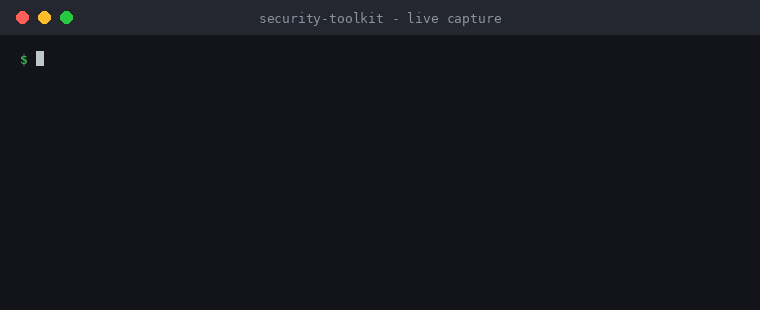

# Security Toolkit

Nine security tools in **Python and Go** with **zero third-party dependencies** —
from subdomain discovery and port scanning to JWT auditing and CVE triage,
wired together by a one-command pipeline. Every tool ships as a standalone
binary and is exercised by unit + integration tests on every push.

[](https://github.com/Abolfazlrwm/Security/actions/workflows/ci.yml)
[](https://github.com/Abolfazlrwm/Security/actions/workflows/release.yml)
[](https://github.com/Abolfazlrwm/Security/blob/main/LICENSE)

> **Authorized use only.** These tools are meant for education, CTFs and
> testing systems you own or have explicit permission to assess.

## Live demo

Live terminal capture — five tools run for real against a local demo
webserver (hash cracking, directory brute force, a port scan, a JWT
audit and the consolidated pipeline). Every line is the tools'
verbatim stdout, recorded in one take:



An older walkthrough GIF built from the captured runs in the
[examples](https://github.com/Abolfazlrwm/Security/tree/main/examples)
directory is [here](https://github.com/Abolfazlrwm/Security/blob/main/docs/demo.gif).

## The tools

| Tool | Language | What it does | Tutorial |
| --- | --- | --- | --- |
| subdomain-enum | Python 3 | Subdomain discovery via crt.sh and threaded DNS brute force | [guide](tutorials/subdomain-enum.md) |
| port-scanner | Python 3 | TCP connect scan of a curated top-100 list with banner grabbing | [guide](tutorials/port-scanner.md) |
| takeover-check | Python 3 | Subdomain takeover detection with CNAME + body fingerprints for 17 hosting services | [guide](tutorials/takeover-check.md) |
| web-audit | Python 3 | TLS certificate + security-header audit that scores targets 0-100 with a letter grade | [guide](tutorials/web-audit.md) |
| jwt-analyzer | Python 3 | Offline JWT audit: decode, verify HMAC signatures, crack weak secrets, flag `alg: none` | [guide](tutorials/jwt-analyzer.md) |
| cve-lookup | Python 3 | Turn banners, keywords or CVE ids into CVSS-ranked CVE lists via the official NVD API | [guide](tutorials/cve-lookup.md) |
| dirbrute | Go | Threaded directory and file brute-forcer with wildcard filtering | [guide](tutorials/dirbrute.md) |
| hashcrack | Python 3 | MD5 / SHA-1 / SHA-256 / SHA-512 cracking with wordlists and rule chains | [guide](tutorials/hashcrack.md) |
| recon-pipeline | Python 3 | Chains four tools into one HTML/JSON/Markdown report | [guide](tutorials/recon-pipeline.md) |

## Downloads

Release tags build **standalone binaries** automatically — no interpreter,
no runtime, no packages — and attach them with sha256 checksums to the
matching GitHub release. Grab them on the
[releases](https://github.com/Abolfazlrwm/Security/releases) page, or browse
the full release-by-release history in
[CHANGELOG.md](https://github.com/Abolfazlrwm/Security/blob/main/CHANGELOG.md).

## Quick start

```console
$ python3 port-scanner/port_scanner.py scanme.nmap.org --top 100
$ python3 jwt-analyzer/jwt_analyzer.py "$TOKEN" --wordlist secrets.txt
$ python3 cve-lookup/cve_lookup.py --from-scan scan.json --severity critical,high
$ python3 recon-pipeline/recon.py --domain example.com   # full report run
```

Every pipeline run writes `report.html` — a self-contained, dark-themed
report page that renders offline — plus `report.md`, `report.json` and the
raw tool logs. See a captured one
[here](https://github.com/Abolfazlrwm/Security/blob/main/examples/recon-pipeline/report.html).

## CI/CD and quality gates

Two GitHub Actions workflows keep the toolkit green and ship the binaries:
[CI](https://github.com/Abolfazlrwm/Security/actions/workflows/ci.yml)
(byte-compile + unit + integration tests on Python 3.11/3.12, `gofmt`/`go vet`/
`go build` on Linux, macOS and Windows) and
[Release binaries](https://github.com/Abolfazlrwm/Security/actions/workflows/release.yml)
(tag-driven builds, each artifact smoke-tested before publish). The full
pipeline documentation lives in
[actions.md](https://github.com/Abolfazlrwm/Security/blob/main/docs/actions.md).

## Project map

- [Source code](https://github.com/Abolfazlrwm/Security) — nine single-file tools
- [Step-by-step tutorials](tutorials/) — every flag explained live
- [Captured examples](https://github.com/Abolfazlrwm/Security/tree/main/examples) — real output from real runs
- [CI/CD pipeline docs](https://github.com/Abolfazlrwm/Security/blob/main/docs/actions.md)
- [CONTRIBUTING.md](https://github.com/Abolfazlrwm/Security/blob/main/CONTRIBUTING.md) ·
  [SECURITY.md](https://github.com/Abolfazlrwm/Security/blob/main/SECURITY.md) ·
  [MIT License](https://github.com/Abolfazlrwm/Security/blob/main/LICENSE)
